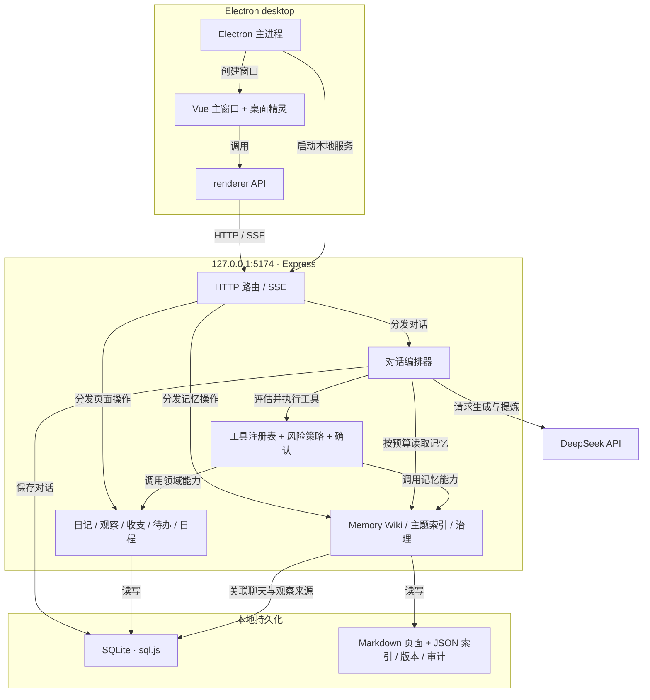

<div align="center">
  

  <p><strong>一个会聊天、能处理日常事务，也允许你追溯和修正记忆的桌面伙伴。</strong></p>

  <p>
    
    
    
    
    
    
  </p>

  <p>
    <a href="#system-architecture">System Architecture</a> ·
    <a href="#memory-by-design">Memory by Design</a> ·
    <a href="#engineering-highlights">Engineering Highlights</a> ·
    <a href="#quick-start">Quick Start</a> ·
    <a href="#product-journey">Product Journey</a>
  </p>
</div>

---

## Cornie at a glance

Cornie（铃湾）把桌面精灵、对话和个人生活数据放在同一个本地应用里：聊天、日记、观察、记忆、收支、待办、日程与设置，共八个界面入口。用户可以用自然语言发起操作，也可以在对应页面直接查看和修改数据。当前对话模型接入 **DeepSeek**；数据在本机持久化，模型调用需要用户配置 API Key 并访问外部服务，对话及按需加载的上下文会发送给模型。

它的核心设计问题是：**如果一个助手会“记得”，用户如何知道它记了什么、凭什么记、又怎样纠正？** Cornie 把长期记忆做成可阅读的 Wiki 页面，并为其提供来源、状态、版本和治理入口。

## System Architecture

**一次交互从桌面窗口进入本地 API；模型负责理解，领域服务负责执行，记忆上下文再回到下一轮对话。**



桌面主进程先启动回环地址上的 API，再创建主窗口和精灵窗口；页面通过健康检查等待服务就绪。渲染层只通过 `src/renderer/api` 访问服务，HTTP 路由把输入交给领域服务，对话编排器统一处理模型协议、工具调用、策略和流式回复。开发态的 Wiki 文件位于项目 `data/memory-wiki/`，打包态位于 Electron `userData/data/memory-wiki/`；SQLite 数据库位于 Electron `userData/cornie.sqlite3`。

### Memory by Design

记忆采用 **“提炼 → 证据化页面 → 分层召回 → 人工治理”** 的闭环。对话结束后，独立的提炼轮让模型给出观察、身份与 Wiki 候选；后端验证结构并执行写入。模型不可用时，本轮记忆提炼**零写入**，只留审计记录，不以关键词规则猜测用户意图。

| 设计环节 | 当前实现 | 为什么这样做 |
| --- | --- | --- |
| 可追溯写入 | Wiki 页记录类型、摘要、状态、重要性、`ownerConfirmed` 与聊天/观察来源；详情可回看来源预览 | 把“记住了”变成可核对的事实，而非黑箱文本 |
| 有预算的召回 | L0 画像卡与已确认的重要人物、L1 候选目录按查询和重要性筛选；默认最多加载 4 页记忆与 4 个主题 | 控制上下文体积，并让召回有明确优先级 |
| 风险分层 | 普通页面创建/更新按提炼结果处理；合并、回滚、归档、删除等破坏性提议进入治理队列 | 让不可轻易撤销的动作经过人审 |
| 可纠正生命周期 | 页面支持状态切换、版本差异与回滚；治理请求有待审、批准、拒绝、延期等合法状态迁移 | 把纠错能力放在产品主路径上 |
| 可复盘存储 | Markdown 页面、主题索引、版本快照和审计日志落在本地；关键快照采用原子写入，JSON 索引写入串行化 | 便于检查、恢复，降低中断写入造成的损坏 |

这里的“治理”不是一个展示页：提炼产生的高风险提议会留下证据，用户批准后仍需显式应用；用户也能直接在记忆页面归档、恢复或回滚。当前使用页面摘要与主题索引做检索和召回，**未接入向量数据库或云端记忆同步**。

## Engineering Highlights

| 技术决策 | 工程意义 | 代码入口 |
| --- | --- | --- |
| Electron 主进程托管本地 Express 服务，API 仅监听 `127.0.0.1:5174` | 桌面 UI 与业务服务解耦，开发态和安装态复用同一接口 | `electron/main.js` · `electron/server.js` |
| JSON 协议 + 工具注册表 + 策略层 | 模型提出动作，执行权留在可校验、可确认的服务端；高风险动作可被拦截 | `electron/backend/agent/` · `electron/backend/tools/` · `electron/backend/policy/` |
| SSE 流式回复与取消，发送请求使用稳定 ID | 对话可逐段展示、可中止；重试时以请求 ID 查找已有消息 | `electron/backend/conversation/` · `electron/backend/agent/orchestrator.js` |
| `safeStorage` 保护模型密钥，设置接口只返回掩码 | 原始密钥不以明文形式存入 SQLite | `electron/main.js` · `electron/backend/settings/service.js` |
| 分层质量门禁与真实 HTTP 契约测试 | 前端行为、后端服务、工具策略和跨层链路都能在本地复验 | `scripts/run-tests.mjs` · `tests/` · `src/**/*.test.js` |

这些边界由 [工程边界与质量约定](doc/Cornie-033-Phase4-%E5%B7%A5%E7%A8%8B%E8%BE%B9%E7%95%8C%E4%B8%8E%E8%B4%A8%E9%87%8F%E7%BA%A6%E5%AE%9A.md) 固化：页面负责交互，renderer API 负责请求契约，路由负责 HTTP 边界，领域服务负责规则和持久化。

## Repository Map

```text
Cornie/
├── src/renderer/           # Vue 页面、组件、样式与 renderer API
│   ├── api/                # 页面与本地 HTTP 服务之间的请求契约
│   └── components/         # 聊天、记忆、生活模块及桌面精灵
├── electron/
│   ├── main.js             # 主进程：窗口、数据目录、本地 API 启动
│   ├── server.js           # Express 路由与服务装配
│   ├── db.js               # sql.js 数据库与持久化
│   └── backend/
│       ├── agent/          # 编排、上下文、协议、记忆提炼
│       ├── memory-wiki/    # 页面、索引、版本、治理与审计
│       ├── policy/         # 工具风险决策
│       ├── tools/          # 工具注册与执行网关
│       └── */              # 日记、观察、收支、待办、日程等领域
├── shared/                 # 前后端共用的日期逻辑
├── tests/                  # 服务、编排、治理、架构与工具测试
├── scripts/                # 测试入口、验收与 Demo 数据脚本
├── doc/                    # 设计、审计、阶段收口与演示材料
├── public/pic/             # 桌面精灵与界面素材
├── index.html              # 主窗口入口
└── cornie.html             # 精灵窗口入口
```

## Quick Start

**环境：** Windows 开发环境、Node.js 20+、npm，以及可用的 DeepSeek API Key。桌面精灵的 Windows 桌面层集成仅在 Windows 上使用；其他平台的打包目标虽有配置，当前发布验证以 Windows NSIS 为准。

```powershell
git clone https://github.com/yejianqin61-cell/Cornie.git
cd Cornie
npm ci
npm run dev
```

启动后会打开主窗口和桌面精灵。进入 **设置** 配置 DeepSeek API Key，即可体验模型对话与记忆提炼；不配置密钥仍可检查本地页面和业务数据，但模型能力不可用。开发服务使用 Vite `127.0.0.1:5173` 和本地 API `127.0.0.1:5174`；若端口被占用，先释放端口再启动。

```powershell
npm run test:fast       # lint + 协议、策略、服务测试
npm run test:full       # 完整质量门禁：前端、后端、契约与验收脚本
npm run build           # 生成 Vite 产物
npm run dist            # 生成 Windows NSIS 安装包（在 Windows 上执行）
```

想单独演示记忆闭环，可按 [Phase 3 演示脚本](doc/Cornie-031-Phase3-%E8%AE%B0%E5%BF%86Demo%E6%BC%94%E7%A4%BA%E8%84%9A%E6%9C%AC.md) 在**隔离目录**装载固定 Demo 数据：

```powershell
npm run load:demo-memory -- --base-dir .\tmp\cornie-demo
```

该命令只写入指定目录，不会自动把 Demo 数据导入当前运行中的用户资料。

## Product Journey

以下节点来自仓库提交历史，展示产品如何从“可见的精灵”走到“可治理的记忆”和“可安装的桌面应用”。

| 时间 | 里程碑 | 可核对的提交 |
| --- | --- | --- |
| 2026-05 | 需求文档与最早的前后端、精灵原型成形 | [`5d344e1`](https://github.com/yejianqin61-cell/Cornie/commit/5d344e1) · [`72113f9`](https://github.com/yejianqin61-cell/Cornie/commit/72113f9) |
| 2026-06 | 转向 DeepSeek；建立 JSON 协议、对话编排、工具网关和风险策略 | [`a0e5559`](https://github.com/yejianqin61-cell/Cornie/commit/a0e5559) · [`f34436d`](https://github.com/yejianqin61-cell/Cornie/commit/f34436d) · [`1db8c29`](https://github.com/yejianqin61-cell/Cornie/commit/1db8c29) |
| 2026-06 | Memory Wiki 的文件存储、主题索引、版本回滚、工具接口与治理队列落地 | [`436f09e`](https://github.com/yejianqin61-cell/Cornie/commit/436f09e) · [`5c5b8e9`](https://github.com/yejianqin61-cell/Cornie/commit/5c5b8e9) · [`2b88d65`](https://github.com/yejianqin61-cell/Cornie/commit/2b88d65) |
| 2026-08 | 记忆主链从关键词抽取转向模型提炼；补足分层注入、文件树浏览和记忆写入一致性 | [`7d63d81`](https://github.com/yejianqin61-cell/Cornie/commit/7d63d81) · [`5ccd32c`](https://github.com/yejianqin61-cell/Cornie/commit/5ccd32c) · [`106d8cd`](https://github.com/yejianqin61-cell/Cornie/commit/106d8cd) |
| 2026-09 | 八个界面入口接入侧栏，桌面精灵与安装包配置进入产品形态 | [`3b970f5`](https://github.com/yejianqin61-cell/Cornie/commit/3b970f5) · [`de172c2`](https://github.com/yejianqin61-cell/Cornie/commit/de172c2) |
| 2026-10 | 真实聊天、日常业务和记忆 Demo 链路闭环；统一质量门禁，验证 Windows 安装与重启读回 | [`bba5845`](https://github.com/yejianqin61-cell/Cornie/commit/bba5845) · [`ba4fc6f`](https://github.com/yejianqin61-cell/Cornie/commit/ba4fc6f) · [`bd61162`](https://github.com/yejianqin61-cell/Cornie/commit/bd61162) |

> **当前版本：** `0.1.0`。项目已经有可复验的本地业务和记忆演示链；真实模型效果仍取决于 DeepSeek 配置与网络，Windows 安装器尚未接入代码签名、自动更新或线上发布渠道。
